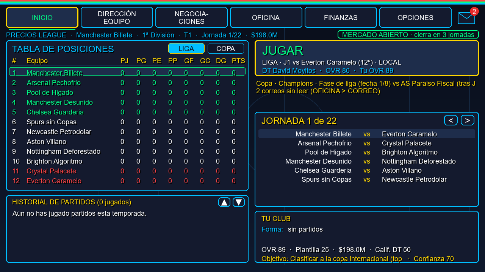
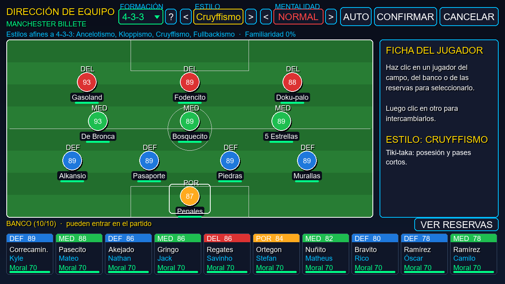
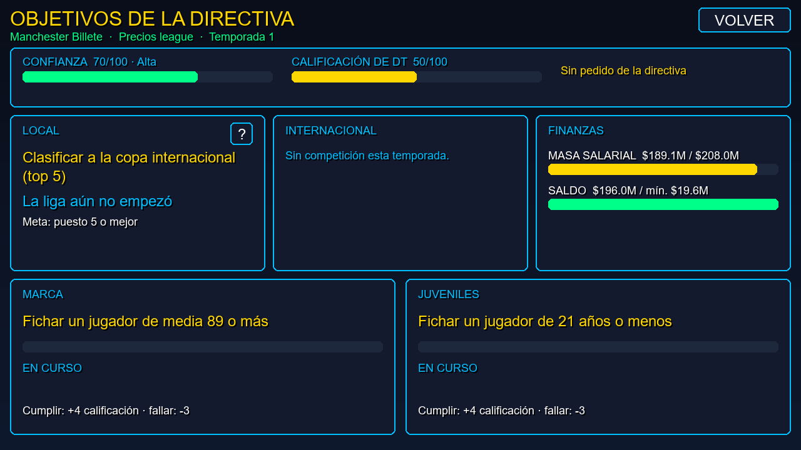
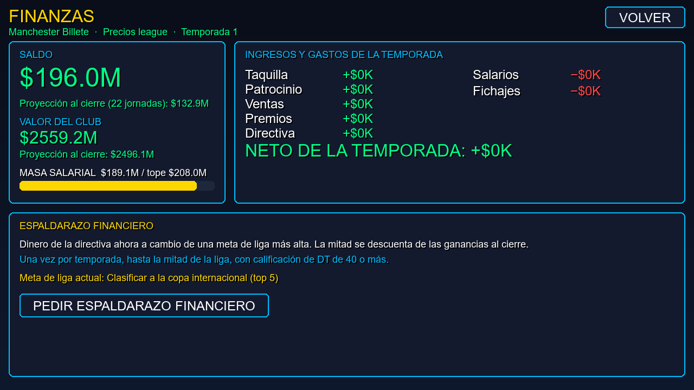

<div align="center">

# ⚽ Alpha Football

**Manager de fútbol de escritorio con estética neón retro y clubes de parodia.**
Dirige un club de 8 países, arma el once, negocia fichajes y préstamos, cuida las finanzas
y cumple (o no) lo que te pide la directiva.




</div>

---

## Qué es

Alpha Football es un simulador de gestión futbolística hecho en **Python + Pygame**. Eres el DT:
eliges club en una de 16 ligas (1ª y 2ª división de 8 países), juegas los partidos en vivo
minuto a minuto y manejas todo lo que pasa fuera de la cancha: mercado, contratos, vestuario,
directiva y dinero. Los clubes y jugadores son parodias (*Manchester Billete*, *Pool de Higado*,
*FC Farcelona*, *Narconal*…).

## Capturas

| Dirección de equipo | Objetivos de la directiva |
|---|---|
|  |  |
| **Finanzas** | **Hub de la carrera** |
|  |  |

## Características

**Ligas y competiciones**
- 8 países (Inglaterra, España, Italia, Brasil, Argentina, Colombia, Uruguay, Ecuador), cada uno con 1ª y 2ª división de 12 equipos, con ascensos y descensos.
- Copa internacional intercalada con la liga (Champions o Libertadores según el continente): fase de liga, playoff, eliminatorias y penales ronda a ronda.
- Las otras ligas se juegan en paralelo: puedes seguirlas desde OTRAS LIGAS.

**Partido y táctica**
- Simulación minuto a minuto con narración, velocidad x1/x2/x5, cambios y dirección en vivo.
- 17 formaciones con selector desplegable y 9 estilos de DT (Cruyffismo, Kloppismo, Choloismo, DeZerbismo…). Cada formación tiene hasta 4 tácticas afines que dan un pequeño bonus.
- Mentalidad, energía, lesiones, tarjetas y sanciones por competición.

**Mercado**
- Ventanas de fichajes (inicio, invierno y cierre), negociación con contraofertas, cláusulas y agentes libres.
- Préstamos de ida y vuelta con el sueldo repartido en %.
- Ofertas de la IA por tus jugadores (marcadas si están en transferibles), ojeador, favoritos e historial de pases.

**Carrera del DT**
- Objetivos por secciones: liga, internacional, finanzas, marca y juveniles, con premios, multas, advertencias y despido.
- Calificación de DT que te sigue entre clubes: con ella llegan ofertas de otros banquillos.
- Finanzas con taquilla, patrocinio, salarios, tope salarial, valor del club, espaldarazo de la directiva y quiebra.
- Vestuario y moral, correo con acciones directas y resumen de fin de temporada.

**Calidad de vida**
- Todo se puede jugar con teclado; la tecla **H** abre la ayuda de cada pantalla.
- 5 ranuras de guardado con guardado atómico y checksum.
- Editor de base de datos (clubes, jugadores, DTs libres) y música importable desde YouTube.

## Instalación

Requisitos: **Python 3.10+** y **pygame** (en `requirements.txt`).

```bash
git clone https://github.com/dajaramilc/AlphaFootball.git
cd AlphaFootball
pip install -r requirements.txt
python main.py
```

Opcional, para importar música desde YouTube en OPCIONES: `pip install yt-dlp` y tener `ffmpeg`
en el PATH (el juego intenta instalar `yt-dlp` solo si falta).

## Controles

| Dónde | Tecla |
|---|---|
| Cualquier pantalla | **H** ayuda contextual · **ESC** volver |
| Hub | **J** jugar · **← →** pestañas · **M** correo · **O** opciones · **R** resultados |
| Dirección de equipo | **flechas** mover · **Espacio** cambiar · **[ ]** formación · **- =** estilo · **, .** mentalidad · **A** auto |

La barra al pie de cada pantalla muestra sus atajos.

## Estructura

```
main.py                 punto de entrada y máquina de estados de pantallas
alpha_football/
  engine.py             motor del partido
  directiva.py          objetivos, calificación de DT, despido
  finanzas.py           ingresos, gastos, tope salarial, quiebra
  market.py, negociacion.py, prestamos.py, mercado_ia.py   mercado
  competiciones.py      copas internacionales
  formaciones.py, estilos.py   táctica
  data/                 ligas, clubes y jugadores de parodia
  ui/                   una pantalla por archivo (hub, partido, dirección, finanzas…)
tests/                  tests por versión (scripts ejecutables)
docs/superpowers/       especificaciones y planes de cada cambio grande
```

## Tests

Cada archivo de `tests/` es un script que se ejecuta solo (usa una ventana *dummy*, no abre nada):

```bash
python tests/test_objetivos_secciones.py
# todos:
for f in tests/test_*.py; do python "$f" || echo "FAIL $f"; done
```

En Windows con consola cp1252, usa `PYTHONIOENCODING=utf-8` para evitar errores al imprimir.

## Licencia

Uso personal / privado. No redistribuir sin autorización del autor.
